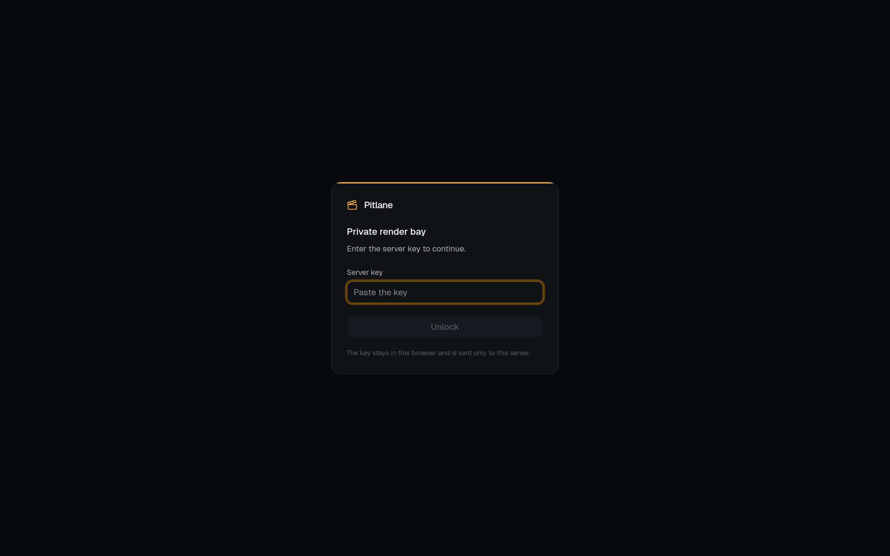
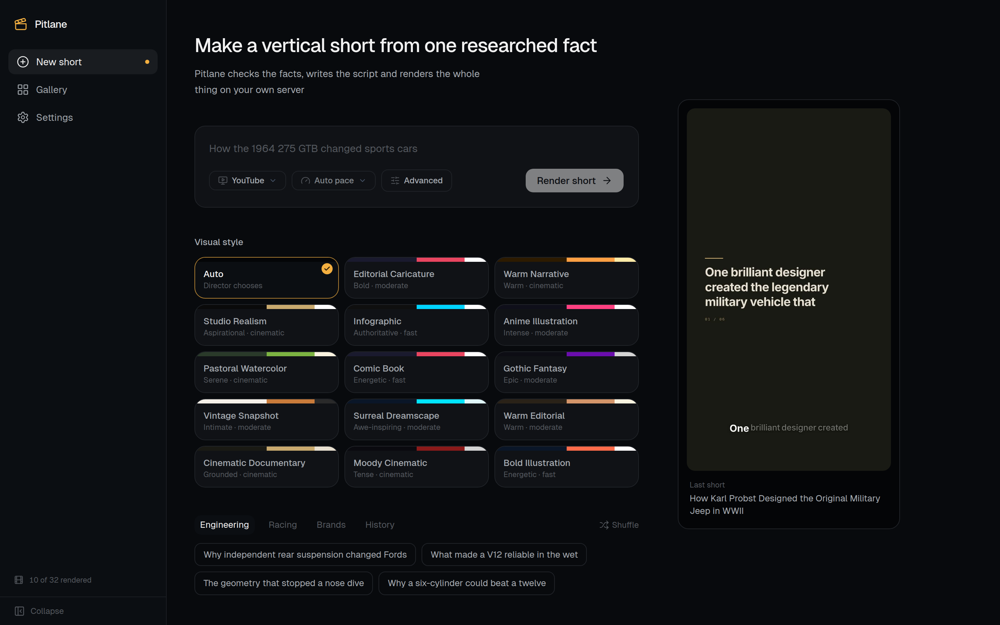
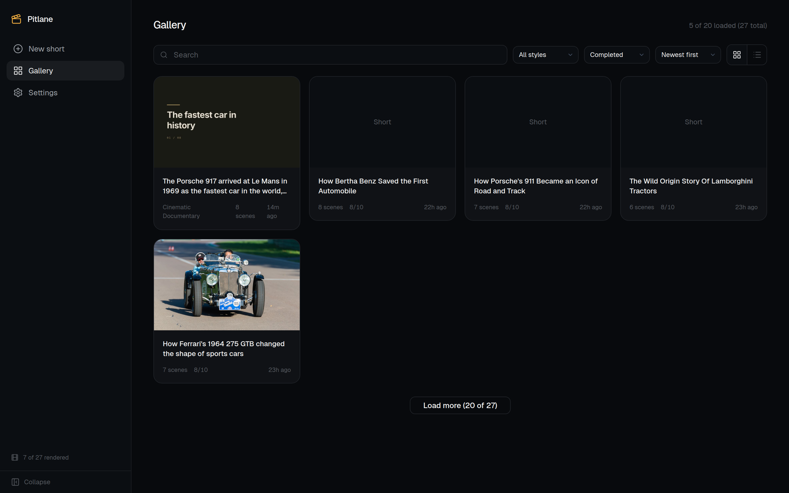
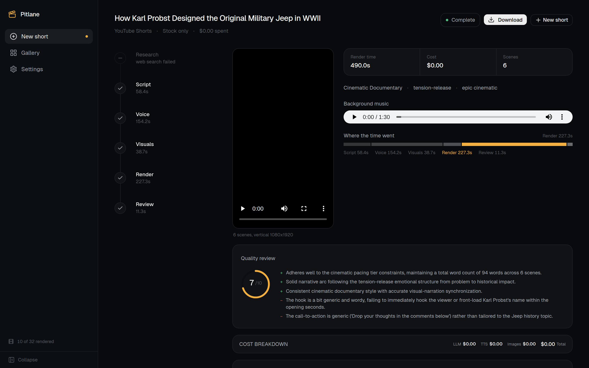
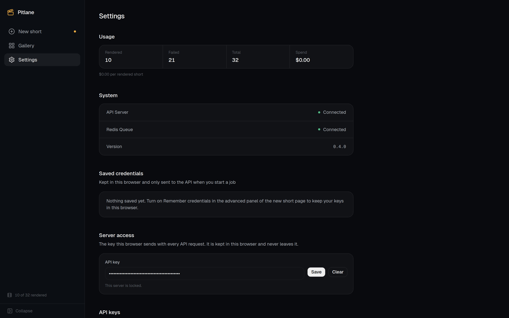

# Pitlane

[](LICENSE)
[](CHANGELOG.md)
[]()
[]()
[]()

Pitlane is the render bay behind a motoring channel. It takes one researched, fact-checked
story and cuts it into a finished vertical short — script, voiceover, footage, captions, music
and render — on your own server, on a schedule.

The topic is researched and verified before anything is rendered: every figure in a video has to
come from a source that was actually read, or the short is not made. The footage is stock, the
graphics are procedural, and the render is yours.

The web app is the control room. A REST API drives it from anything that can make an HTTP
request.

## What changed on top of upstream

Pitlane started as a fork of [tsensei/OpenReels](https://github.com/tsensei/OpenReels), which
provided the pipeline and the renderer. The changes here are what turned it into an unattended
publishing system:

- **Automation REST API** — versioned endpoints with an OpenAPI 3.1 schema and interactive docs,
  optional authentication, idempotent job creation, batch creation, filtered listing, retry,
  cancel, delete, artifact listing, and server-sent events for progress.
- **Stock-only mode** — `noAiAssets` disables AI image and video generation, leaving real
  footage from Pexels, Pixabay and Wikimedia Commons, with procedural text cards for the rest.
  No image or video API key is required.
- **Render resilience** — the Remotion delayRender timeout is now passed to the renderer
  correctly, LLM rate limits are retried with backoff, and a job orphaned by a server restart
  fails instead of blocking the queue.
- **Model fallback chain** — a job can list backup models; the render falls back to the next
  model when the primary fails, with a bounded retry window per model.
- **Research that runs** — the stage searches the web (Tavily when a key is set, Wikipedia when
  it is not) and turns what it read into a brief with sources. A fact the caller already
  verified is part of the brief, not a reason to skip the research.
- **A voice that sounds like one channel** — every engine gets the same ear-ready script
  (units, symbols and abbreviations written out, long sentences broken at a comma) and the same
  broadcast mastering (`-14 LUFS`, `-1.5 dBTP`, de-essed, 192 kbps). Kokoro, a local neural
  narrator, is the default; Piper stands behind it as a fallback.

Publishing is owned by the calling automation, so YouTube support has been removed from the
engine itself.

## Screenshots

<div align="center">


<em>The server is private. The control room does not render until a key is entered.</em>
</div>

<br />

<table>
<tr>
<td></td>
<td></td>
</tr>
<tr>
<td align="center"><em>One fact in, one short out. Styles and topics sit under the topic field.</em></td>
<td align="center"><em>Every short, with the stage it stopped at if it failed.</em></td>
</tr>
<tr>
<td></td>
<td></td>
</tr>
<tr>
<td align="center"><em>The render, its stage timings, and what it cost.</em></td>
<td align="center"><em>Server state, saved credentials, and the key this browser sends.</em></td>
</tr>
</table>

## How it works

Give it a topic. It handles everything:

| Stage | What happens |
|-------|-------------|
| **Research** | Web search grounds the script in real facts, not hallucinations |
| **Script** | Writes a punchy short-form script with scene breakdowns, visual direction, and emotional arc |
| **Voiceover** | Generates TTS audio with word-level timestamps for karaoke-style captions |
| **Visuals** | AI images (Gemini, DALL-E), AI video clips (Google Veo 3.1, fal.ai Kling 2.6 Pro) with dedicated cinematography prompts and negative prompt guidance, plus vision-verified stock footage that rejects bad matches and retries automatically |
| **Music** | AI-generated background score via Google Lyria 3 Pro, scene-synced to match the video's emotional arc. Or pick from 25 bundled royalty-free tracks |
| **Captions** | Spring-animated 3-state captions with 7 distinct styles, per-archetype theming, and word-level karaoke highlighting |
| **Assembly** | Composites everything into a vertical MP4 via Remotion with crossfade, slide, wipe, and flip transitions |
| **Critique** | AI critic scores the output. If quality is below threshold, the pipeline re-runs |

Every stage streams live progress to the web UI. You watch the AI research, write, paint, compose, and render in real time.

### The voice

The narrator is Kokoro, a local neural voice that runs on the CPU and costs nothing per short.
It is baked into the image, the build proves it can speak before the image ships, and Piper
stands behind it as a fallback.

The voiceover is treated as a mix, not as an API response. Before synthesis the script is
rewritten for the ear: `40%` becomes "40 percent", `km/h` becomes "kilometres per hour", `e.g.`
becomes "for example", a dash becomes a comma, and a sentence that runs past 28 words is broken
at a pause the writer already asked for. After synthesis the audio is mastered once, whatever
engine made it: 70 Hz high pass, a gentle de-esser, two-pass loudness towards `-14 LUFS` with
a `-1.5 dBTP` ceiling, 44.1 kHz mono at 192 kbps.

Mastering is gain and tone only, never a timing change, so word timestamps and captions stay
exact. If ffmpeg is unavailable the original audio is kept, because a render is never lost to a
mix.

### The research

The script is grounded in sources, not in the model's memory. The research stage searches the
web through Tavily when a key is set, and through Wikipedia when it is not - Wikipedia's API
needs no key, and the facts it returns come with a page the video can cite.

A caller may hand over a fact that was already checked somewhere else. That fact is part of the
brief, not a replacement for the research: the stage still searches, because a script built on
one fact is a script that can only say one thing.

### The footage

Scenes are cut from stock, never generated. Three libraries are searched: Pexels and Pixabay
when their keys are set, and Wikimedia Commons, which needs no key, is free-licensed, and is
deep in motorsport photography and public-domain film. Every Commons asset carries its licence
and author into the job's credits.

A visual judge checks each candidate against the scene. It judges the subject, not the staging:
a parked racing car is a usable frame for a scene about a racing car, because the frame is
cropped to vertical and given a slow camera move. A named model is a named model, though: a
Mustang wearing a Ferrari badge is not an F40.

A text card is the exception, not the default. The script allows two of them in a whole video
(the title, the call to action, a number that cannot be shown), and a scene whose footage cannot
be found is looked up as the other kind of footage before it falls back to a card.

Every scene carries the same grade, which is what stops a finished video looking like a
slideshow: a little more contrast, the archetype's colour laid over the picture, a vignette
that pulls the eye to the middle, and a scrim that keeps the captions readable. The footage
also gets a slow move across the shot, because a still frame of a car looks like a screenshot.

## Provider flexibility

Mix and match providers or go all-in on one ecosystem:

| Capability | Providers |
|-----------|-----------|
| **LLM** | Anthropic Claude, OpenAI GPT, Google Gemini, OpenRouter (300+ models), any OpenAI-compatible endpoint |
| **Search** | Native (provider built-in), Tavily, or parametric knowledge |
| **TTS** | Kokoro (free, local, the default), Piper (free, local, ~20× real time, the fallback), ElevenLabs, Inworld, OpenAI TTS, Gemini TTS |
| **Images** | Gemini Imagen, OpenAI DALL-E |
| **Video** | Google Veo 3.1, fal.ai Kling 2.6 Pro (with cross-provider fallback, negative prompts, structured cinematography prompts) |
| **Music** | Google Lyria 3 Pro (AI-generated, $0.08/track), Bundled library (free) |
| **Stock** | Pexels, Pixabay and Wikimedia Commons, all three searched, judged on the subject, with AI fallback |

**One key, everything Google:** `--provider google` sets LLM, images, TTS, video, and music to Google APIs with a single `GOOGLE_API_KEY`.

**Zero-cost voiceover:** `--tts-provider kokoro` uses Kokoro, a local neural voice that reads like a person. `--tts-provider piper` uses Piper, which synthesises at roughly twenty times faster than real time. The two back each other up: if one cannot speak, the other does, and the render is not lost to a missing file. No API key needed for either.

**No AI assets:** add `--no-ai-assets` to skip AI image and video generation entirely. Scenes use vision-verified stock media and procedural text cards, so no image or video API key is required.

## Quickstart

### Web UI (recommended)

```bash
git clone https://github.com/arjav1181/Pitlane.git
cd Pitlane
cp .env.example .env   # fill in your API keys
docker compose up      # starts Redis + API + Worker
# Open http://localhost:3000
```

Type a topic, pick your providers, and watch the pipeline run. Research, script, voiceover, visuals, music, and assembly stages stream live to the browser. Download the final video when it's done.

The web UI can also take an API key for a custom OpenAI-compatible endpoint (choose the auth mode: Bearer, custom header, or none) and remember your credentials in the browser so you only enter them once.

If the server was started with `OPENREELS_API_KEY`, the UI opens on a sign-in screen and will not render anything until the key is entered. Set `OPENREELS_AUTH_REQUIRED=true` and a missing key is a 503 instead of an open door. See the [Web UI guide](https://openreels.tsensei.dev/docs/getting-started/web-ui) for details.

### Automation API

The server exposes a REST API designed for automation:

- **OpenAPI 3.1** — machine-readable schema at `/api/v1/openapi.json`, interactive docs at `/api/v1/docs`
- **Optional server auth** — set `OPENREELS_API_KEY` and send `Authorization: Bearer`, `X-API-Key`, or `?api_key=` (for EventSource and media URLs)
- **Idempotency** — `Idempotency-Key` header returns the original job on replay
- **Batch creation** — up to 25 jobs per request with per-item errors
- **Signed webhooks** — HMAC-SHA256 callbacks for `job.completed`, `job.failed`, and `job.cancelled`
- **Full lifecycle** — filter/list, inspect, retry, cancel, delete, list artifacts, download video/score/log, and stream SSE progress
- **Stock-only mode** — `"noAiAssets": true` disables AI image/video generation and uses stock media plus procedural text cards
- **YouTube integration** — read channel analytics with a Data API key and publish finished videos from the server

A ready-made n8n workflow that runs the whole loop on a schedule (research topics → render → publish)
lives in [`n8n/`](./n8n).


The server exposes a REST API designed for automation:

```bash
curl -X POST http://localhost:3000/api/v1/jobs \
  -H "Content-Type: application/json" \
  -H "Idempotency-Key: coffee-001" \
  -d '{"topic":"The history of coffee","noAiAssets":true}'
```

See the [REST API reference](https://openreels.tsensei.dev/docs/api/rest) for the complete surface.

### Docker CLI (single run)

```bash
cp .env.example .env   # fill in your API keys

docker run --env-file .env --shm-size=2gb -v ./output:/output ghcr.io/tsensei/openreels "5 stoic lessons that changed my life"
```

Or run through Docker Compose:

```bash
docker compose run worker npx tsx src/index.ts --yes "5 stoic lessons that changed my life"
```

### Local development

**Prerequisites:** Node.js 22+, pnpm, ffprobe

```bash
git clone https://github.com/arjav1181/Pitlane.git
cd Pitlane
pnpm install
cp .env.example .env   # fill in your API keys
```

```bash
# Full pipeline with AI music
pnpm start "the fall of the Roman Empire" --provider google

# Free local TTS, no API spend on voiceover
pnpm start "5 stoic lessons" --provider local

# Dry run (outputs DirectorScore JSON, no asset generation)
pnpm start "your topic" --dry-run

# Specific archetype and provider combo
pnpm start "your topic" --archetype anime_illustration --provider openai

# Creative direction file (guide the AI with a brief)
pnpm start "deep sea exploration" --direction examples/direction-brief.md

# Replay from a previous score (skip research + director, re-render)
pnpm start "your topic" --score output/2026-04-10-111939-.../score.json
```

### API keys

**Minimum to run** (pick one LLM + one TTS):
- `ANTHROPIC_API_KEY` or `OPENAI_API_KEY` or `GOOGLE_API_KEY` — [Anthropic](https://console.anthropic.com/) / [OpenAI](https://platform.openai.com/api-keys) / [Google AI Studio](https://aistudio.google.com/apikey)
- `ELEVENLABS_API_KEY` or `INWORLD_TTS_API_KEY` — [ElevenLabs](https://elevenlabs.io/) / [Inworld](https://inworld.ai/). Or use `--tts-provider piper` (free, no key, recommended), `--tts-provider kokoro` (free, no key), `--tts-provider openai-tts`, or `--tts-provider gemini-tts`
- `GOOGLE_API_KEY` — also needed for Gemini image generation, AI video (Veo), AI music (Lyria), and Gemini TTS

**Optional:** `PEXELS_API_KEY` ([Pexels](https://www.pexels.com/api/)), `PIXABAY_API_KEY` ([Pixabay](https://pixabay.com/api/docs/)) for stock footage. Wikimedia Commons needs no key. `TAVILY_API_KEY` ([Tavily](https://tavily.com/)) for web research; without one the research stage searches Wikipedia. `FAL_API_KEY` ([fal.ai](https://fal.ai/)) for Kling video generation

**Server and automation:** `OPENREELS_API_KEY` (require auth on every API route), `OPENREELS_AUTH_REQUIRED` (fail closed: without a key the API answers 503 instead of serving the whole surface), `PIPER_BINARY` / `PIPER_MODEL` (the local narration engine), `OPENREELS_RENDER_CRF` (video quality, default 23), `OPENREELS_CORS_ORIGIN` (browser origins), `OPENREELS_ALLOW_PRIVATE_CALLBACKS` (internal webhook targets), `OPENREELS_NO_AI_ASSETS` (default to stock + procedural visuals), `OPENREELS_LLM_AUTH` / `OPENREELS_LLM_AUTH_HEADER` (OpenAI-compatible auth defaults), `OPENREELS_LLM_TIMEOUT_MS` (per-request ceiling, default 180000), `OPENREELS_LLM_FALLBACK_MODELS` (comma-separated backup models tried in order when the primary fails), `OPENREELS_LLM_FALLBACK_BUDGET_MS` (total wall-clock budget for the fallback chain, default 300000), `OPENREELS_LLM_FALLBACK_RETRY_BUDGET_MS` (how long one model may spend retrying a rate limit before the chain moves on, default 45000), `OPENREELS_RENDER_TIMEOUT_MS` (Remotion delayRender timeout, default 120000), `OPENREELS_RENDER_CONCURRENCY` (parallel browser tabs, default 1), `OPENREELS_RENDER_OFFTHREAD_CACHE_MB` (OffthreadVideo frame cache, default 1024). See the [REST API reference](https://openreels.tsensei.dev/docs/api/rest).

### CLI flags

| Flag | Description | Default |
|------|-------------|---------|
| `--provider <name>` | LLM provider (`anthropic`, `openai`, `gemini`, `openrouter`, `openai-compatible`, `google`, `local`) | `anthropic` |
| `--llm-model <model>` | Model ID override (e.g. `anthropic/claude-sonnet-4` for OpenRouter) | provider default |
| `--llm-base-url <url>` | Base URL for `openai-compatible` (e.g. `http://localhost:11434/v1`) | — |
| `--llm-auth <mode>` | Auth mode for `openai-compatible` (`auto`, `bearer`, `custom-header`, `none`) | `auto` |
| `--llm-auth-header <name>` | Header name for `--llm-auth custom-header` (e.g. `x-api-key`) | — |
| `--search-provider <name>` | Search provider (`native`, `tavily`, `none`) | auto-detect |
| `--image-provider <name>` | Image provider (`gemini`, `openai`) | `gemini` |
| `--tts-provider <name>` | TTS provider (`elevenlabs`, `inworld`, `piper`, `kokoro`, `gemini-tts`, `openai-tts`) | `elevenlabs` |
| `--music-provider <name>` | Music provider (`bundled`, `lyria`) | `bundled` |
| `--video-provider <name>` | Video provider (`gemini`, `fal`) | auto-detect |
| `--archetype <name>` | Override visual archetype | LLM chooses |
| `--platform <name>` | Target platform (`youtube`, `tiktok`, `instagram`) | `youtube` |
| `--dry-run` | Output DirectorScore JSON without generating assets | off |
| `--preview` | Open Remotion Studio after rendering | off |
| `-o, --output <dir>` | Output directory | `./output` |
| `--no-music` | Disable background music | music on |
| `--no-video` | Disable AI video generation | video on |
| `--no-ai-assets` | Disable AI image and video generation; use stock media and procedural text cards only | AI assets on |
| `--no-stock-verify` | Disable VLM stock footage verification | verify on |
| `--stock-confidence <n>` | Min confidence for stock verification (0-1) | `0.6` |
| `--stock-max-attempts <n>` | Max stock API calls per scene | `4` |
| `--video-model <model>` | Video model override | provider default |
| `--kokoro-voice <voice>` | Kokoro voice preset | `am_michael` |
| `--direction <file>` | Creative brief file (markdown) to guide the AI | — |
| `--score <path>` | Replay from a saved `score.json`, skipping research + director | — |
| `-y, --yes` | Auto-confirm cost estimation (Docker/CI) | off |

## Cost transparency

Before spending any money, the pipeline shows a detailed cost breakdown and asks for confirmation:

```
Estimated cost: $0.686
  LLM:    $0.0029 (7 calls)
  TTS:    $0.0171 (853 chars)
  Images: $0.3030 (3 AI images @ $0.101/ea)
  Video:  $0.3000 (1 AI videos)
  Music:  $0.0802 (Lyria AI generation)
  Stock:  free
```

After rendering, actual cost is computed from real token usage. Use `--dry-run` to preview the DirectorScore without spending anything.

## Archetypes

Each style sets the palette, the type, the caption treatment and how the camera moves, so one
topic reads differently in each. In stock-only mode the visuals come from footage and procedural
cards, so the style is carried by grade, type and motion rather than by generated art.


| Archetype | Best for |
|-----------|----------|
| `editorial_caricature` | News commentary, satire, social issues |
| `warm_narrative` | Storytelling, history, human interest |
| `studio_realism` | Professional photography, editorial, luxury |
| `infographic` | Data, facts, explainers, rapid-fire content |
| `anime_illustration` | Dynamic, action-oriented, pop culture |
| `pastoral_watercolor` | Nature, contemplative, hand-painted aesthetic |
| `comic_book` | Action, adventure, energetic content |
| `gothic_fantasy` | Dark themes, mythology, epic content |
| `vintage_snapshot` | Nostalgic, intimate, personal stories |
| `surreal_dreamscape` | Sci-fi, fantasy, mind-bending topics |
| `warm_editorial` | Lifestyle, people stories, general purpose |
| `cinematic_documentary` | Factual, historical, science |
| `moody_cinematic` | Mystery, tension, crime, dark history |
| `bold_illustration` | Educational, how-to, listicles |

## Background

Pitlane began as a fork of [tsensei/OpenReels](https://github.com/tsensei/OpenReels), a
TypeScript pipeline that writes, voices and renders short-form video with Remotion. The fork
turns it into an unattended publishing system: a keyed REST API, a stock-only render mode, a
research pass that can be replaced by a verified fact, and a local narrator that sounds like one
channel.

The original project was itself a rewrite of ReelMistri, a Python CLI built for Bangla-language
Shorts automation. It proved the concept; this project keeps the idea and drops the Python
bridge.

## Status

See [CHANGELOG.md](CHANGELOG.md) for the full version history and [TODOS.md](TODOS.md) for known issues and the roadmap.

## Credits

Pitlane is built on [tsensei/OpenReels](https://github.com/tsensei/OpenReels), which provided the
pipeline and the Remotion renderer. If that project is useful to you, consider giving it a star.

[](https://star-history.com/#tsensei/OpenReels&Date)

## License

This project is licensed under the [MIT License](LICENSE).
